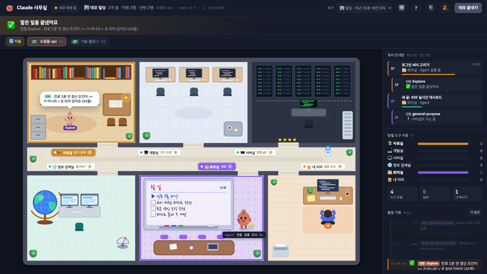

# 🏢 Claude 사무실

**Claude Code가 지금 뭘 하고 있는지 한눈에 보여 주는 작은 사무실 빌딩.**
Claude Code가 남기는 세션 기록을 0.25초마다 따라 읽어서, Claude 캐릭터가 방을 오가며 일하는 모습으로 보여 줍니다.
Claude Code를 여러 개 켜 두면 세션마다 직원이 한 명씩 생기고, 프로젝트마다 층이 나뉘고, 서브에이전트는 인턴으로 출근해요.



*데모 화면이에요. 주소 뒤에 `?demo`를 붙이면 똑같이 볼 수 있어요.*

> 개인이 만든 비공식 도구예요. Anthropic과는 관련이 없어요.

---

## 이런 걸 보여 줘요

### 🏢 빌딩: 여러 세션을 한꺼번에

- **세션 하나 = 직원 한 명.** 최근 30분 안에 움직인 Claude Code 세션이 모두 출근해요. 직원마다 색이 달라요. 30분 넘게 조용하면 걸어 나가 퇴근하고, 다시 일하면 출근해요. (빌딩에 아무도 없으면 허전하니까 마지막 한 명은 남아요.)
- **프로젝트 하나 = 층 하나.** 같은 폴더에서 일하는 세션은 같은 층에 모여요. 위쪽 층 버튼으로 오가고, **🛗 자동**이 켜져 있으면 나를 기다리는 직원이 있는 층, 아니면 일이 생기는 층으로 알아서 엘리베이터를 타요.
- **서브에이전트 = 인턴.** Claude가 서브에이전트(Agent 도구)를 부르면 작은 인턴이 복도에서 걸어 들어와 맡은 일을 하고, 끝나면 결과를 말하고 퇴근해요.
- **로비 안내판**(오른쪽 위)에 모든 층의 직원·인턴이 지금 뭘 하는지 나와요. **나를 기다리는 직원이 맨 위**에 오고, 누르면 그 층으로 가요.
- 같은 방에 여러 명이 들어오면 자리를 나눠 서고, 이름표와 도구 표지판이 겹치지 않게 달려요.

### 방마다 하는 일

Claude가 쓰는 도구에 따라 캐릭터가 알맞은 방으로 걸어가요.

| 방 | 이럴 때 가요 |
|---|---|
| 📚 **자료실** | 파일 읽기·검색 (Read, Glob, Grep) |
| 💻 **개발실** | 코드 수정 (Edit, Write) |
| 🖥️ **서버실** | 명령 실행 (Bash, PowerShell). git 명령이면 표지판에 `git` 표시 |
| 🌐 **정보 검색실** | 웹 검색, 웹 페이지 읽기, MCP 도구 |
| 🗂️ **회의실** | 계획 세우기 — 할 일 목록을 **화이트보드**에 손글씨로 적고 하나씩 체크 |
| 🙋 **내 자리** | 물어볼 게 생기면 **내 책상까지 찾아와서** 질문, 일이 끝나면 와서 완료 보고 |

처음 보는 도구는 이름을 보고 어울리는 방으로 가요. 도구가 가는 방을 직접 정하고 싶다면 [아래](#도구가-가는-방-바꾸기)를 보세요. 예를 들어 이름에 `Run`이 들어가면 서버실, `List`·`Search`가 들어가면 자료실로 가요.

그리고 이런 모습도 있어요.

- 💭 **생각 중**일 때는 머리 위에 구름 말풍선이 떠요. 기록에 생각 요약이 있으면 그 내용을 보여 줘요.
- 😰 **도구가 실패하면** 눈이 `> <`가 되고 식은땀을 흘리면서 빨간 말풍선에 오류 내용을 띄워요.
- 🔐 **권한 확인 창이 뜨면** 내 자리로 와서 허락서를 들고 기다려요. 어떤 명령인지, 몇 초째 기다리는지 보여 줘요. ([플러그인](#방법-d-claude-code-플러그인으로-설치-권한-대기까지-보기)이나 [hooks](#권한-확인-대기까지-보기-hooks)를 켜야 해요)
- 🗜 **대화를 압축하는 동안**(1~2분쯤)은 '지난 대화를 요약하는 중…' 구름을 띄우고 몇 초째인지 보여 줘요. 그동안 기록이 조용해서 멈춘 것처럼 보이지 않게요. (이것도 플러그인이나 hooks를 켜야 해요)
- 😴 한동안 할 일이 없으면 책상 옆에서 졸아요.
- ⏳ **사용 한도에 걸리면** 졸면서 '오전 12:40에 다시 열려요'처럼 언제 다시 일할 수 있는지 보여 줘요. 그 시각이 되면 '사용 한도가 풀렸어요'라고 알려 줘요. 인터넷이 끊기거나 로그인이 풀려서 일이 멈추면 왜 멈췄는지 보여 주고요. 로비 안내판에도 노랑·빨강으로 표시돼요.
- 화면 위쪽에는 **지금 하는 일**과 경과 시간이 나와요.
- 📏 **컨텍스트가 얼마나 찼는지**도 같이 나와요. 60%를 넘으면 노랑, 85%를 넘으면 빨강이에요. 캐릭터 발치에도 찬 만큼 서류가 쌓이고(20%마다 한 장, 많이 차면 노랑·빨강 포스트잇), 대화를 압축하면 정리돼서 줄어들어요. 꽉 차면 Claude Code가 대화 앞부분을 요약하니까, 빨개지면 곧 압축된다는 뜻이에요. 로비 안내판에도 직원마다 작은 막대로 보여요.
- 오른쪽에는 **방별 도구 사용량, 실패 횟수, 활동 기록**이 나와요.

---

## 시작하기

### 1단계. Node.js 준비하기 (처음 한 번만)

이 프로그램은 **Node.js 18 이상**만 있으면 돌아가요. 따로 설치할 패키지는 없어요.

터미널(Windows는 PowerShell이나 명령 프롬프트)을 열고 아래를 입력해 보세요.

```bash
node -v
```

`v18.0.0`보다 높은 숫자가 나오면 준비 끝이에요. Claude Code를 npm으로 설치했다면 이미 있을 거예요.
"node를 찾을 수 없다"는 말이 나오면 [nodejs.org](https://nodejs.org)에서 **LTS** 버전을 설치하고, 터미널을 껐다가 다시 열어 주세요.

### 2단계. 실행하기

아래 방법 중 **편한 것 하나만** 고르세요.

#### 방법 A. 설치 없이 한 줄로 실행 (가장 간단)

```bash
npx https://github.com/holyrootx/claude-office/archive/refs/heads/main.tar.gz
```

처음 한 번만 "Ok to proceed? (y)"라고 물으면 `y`를 누르세요.

#### 방법 B. ZIP으로 내려받아 실행

1. 이 페이지 위쪽 초록색 **Code** 버튼 → **Download ZIP**을 눌러 내려받고 압축을 풀어요.
2. 실행해요.
   - **Windows**: 풀린 폴더에서 `start.cmd`를 더블클릭해요.
   - **Mac / Linux**: 터미널에서 풀린 폴더로 이동해 실행해요.
     ```bash
     cd 내려받은-폴더/claude-office-main
     node server.js
     ```

#### 방법 C. git으로 받아서 실행

```bash
git clone https://github.com/holyrootx/claude-office.git
cd claude-office
npm start
```

#### 방법 D. Claude Code 플러그인으로 설치 (권한 대기까지 보기)

Claude Code 안에서 아래 두 줄을 입력하세요.

```
/plugin marketplace add holyrootx/claude-office
/plugin install office@holyrootx
```

설치한 뒤에는 Claude Code에서 이렇게 켜고 꺼요. 터미널 창을 따로 켜 둘 필요가 없어요.

| 명령 | 하는 일 |
|---|---|
| `/office:open` | 사무실을 뒤에서 켜고 브라우저로 열어요. 이미 켜져 있으면 화면만 열고, 켜져 있는 게 예전 버전이면(플러그인을 업데이트한 뒤) 끄고 새 버전으로 다시 켜요. |
| `/office:stop` | 사무실을 꺼요. |
| `/office:journal` | 오늘의 업무 일지를 Claude Code 안에 보여 줘요. `/office:journal 어제`처럼 다른 날도 볼 수 있어요. |

플러그인에는 [권한 확인 대기를 알려 주는 hooks](#권한-확인-대기까지-보기-hooks)가 들어 있어서, 따로 설정하지 않아도 권한 대기 장면이 나와요.

### 3단계. 화면 보기

실행하면 브라우저가 **자동으로 열려요.** 안 열리면 브라우저 주소창에 직접 입력하세요.

```
http://localhost:4777
```

터미널에 이런 글이 보이면 잘 켜진 거예요.

```
  🏢 Claude 사무실이 열렸어요 → http://localhost:4777
  📂 세션 기록 폴더: C:\Users\나\.claude\projects
  ⏱  250ms마다 최신 세션을 따라 읽는 중… (끄려면 Ctrl+C)
```

> ⚠️ 이 터미널 창은 **켜 둔 채로** 두세요. 창을 닫으면 화면도 멈춰요.

### 4단계. Claude Code 쓰기

**다른 터미널 창**에서 평소처럼 Claude Code를 실행하고 일을 시키면 돼요.

```bash
claude
```

Claude가 파일을 읽으면 자료실로, 코드를 고치면 개발실로 캐릭터가 걸어가요.
아직 Claude Code를 안 켰다면, 먼저 화면 오른쪽 위의 **데모 보기** 버튼으로 어떤 모습인지 구경해 보세요.

### 끄기

서버를 켠 터미널에서 `Ctrl + C`를 누르거나 그 창을 닫으면 돼요.

---

## 화면 사용법

- **보기** (오른쪽 위)
  - **🏢 빌딩** (기본): 최근 30분 안에 움직인 세션을 모두 보여 줘요. 권한을 기다리는 세션과 사용 한도가 풀리기를 기다리는 세션(⏳)은 오래됐어도 데려와요.
  - **자동 · 가장 최근 세션 하나**: 예전처럼 한 명만 따라가요. 다른 세션이 새로 움직이면 그쪽으로 갈아타요.
  - 목록에서 **세션을 고르면** 그 세션 하나만 고정해서 봐요.
- **층 버튼**: 층이 둘 이상이면 나와요. 층을 누르면 그 층에 머물고, **🛗 자동**을 누르면 다시 일이 생기는 층으로 따라가요. 🔐가 붙은 층에는 나를 기다리는 직원이 있어요.
- **로비 안내판·활동 기록**: 줄을 누르면 그 사람이 있는 층으로 가서 정보 카드를 열어 줘요. "이건 누가 한 거지?" 할 때 활동 기록 줄을 눌러 보세요.
- **캐릭터를 누르면** 옆에 정보 카드가 떠요. 지금 하는 일, 컨텍스트, 도구·실패 수, 그 세션에서 만든 PR 링크, 쓴 돈(Claude Code가 남긴 API 요금 기준)과 바꾼 줄 수가 나오고, `⏪ 다시 보기`(처음부터), `📌 이 세션만 보기`, `📋 이어 하기 명령 복사` 버튼이 있어요. 이어 하기 명령(`cd 그 폴더 && claude --resume 세션id`)을 터미널에 붙여 넣으면 닫아 둔 세션을 이어서 할 수 있어요. 하위 폴더나 워크트리에서 일하는 중이면 `📂 frontend`, `🌿 fix-login`처럼 어디인지도 나와요. 인턴을 누르면 누구의 인턴이고 무슨 일을 맡았는지, 도구를 몇 번 썼고 얼마나 일했는지 보여요. 빈 곳을 누르거나 Esc를 누르면 닫혀요.
- **⏪ 다시 보기** (오른쪽 위): 보기 메뉴에서 고른 세션을, 고르지 않았으면 지금 보는 직원의 세션을 처음부터 빠르게 다시 보여 줘요. 오래 쉬던 시간은 줄여서 보여 주고, 옆의 `10×` 버튼으로 5배·10배·30배를 오가요. 활동 기록에는 원래 시각이 찍혀요. 다시 보는 동안 위쪽에 노란 진행 막대가 나오는데, 원하는 곳을 누르면 그 시점의 사무실로 바로 건너뛰어요. ⏸로 멈췄다가 이어 볼 수 있고, ⏹을 누르면 실시간으로 돌아와요.
- **단축키**
  | 키 | 하는 일 |
  |---|---|
  | `1`~`9` | 그 층으로 가요 |
  | `0` | 층 자동으로 돌아가요 |
  | `Space` | 다시 보기 멈추기·이어 보기 |
  | `←` `→` | 다시 보기에서 5%씩 앞뒤로 |
  | `?` | 도움말 (방·캐릭터 모습·버튼·단축키를 한눈에) |
  | `J` | 업무 일지 열기·닫기 (한글 자판이어도 돼요) |
- **? 도움말** (오른쪽 위): 방이 뭘 하는 곳인지, 캐릭터 모습이 무슨 뜻인지, 무엇을 누르고 어떤 키를 쓰는지 한 장에 모아 보여 줘요. `?` 키로도 열어요.
- **📓 업무 일지** (오른쪽 위, `J` 키): 오늘 자정부터 Claude가 한 일을 프로젝트별로 모아 보여 줘요. `◀` `▶`(또는 `←` `→` 키)로 지난 날 일지도 넘겨 볼 수 있어요. 위쪽 막대 24개는 시간대별 도구 사용이라, 하루 중 언제 일했는지 한눈에 보여요. `📋`를 누르면 그날 일지를 마크다운으로 복사해서 슬랙·노션에 하루 보고로 붙여 넣을 수 있어요. 일한 시간, 내 메시지, 도구, 실패, 인턴 수, 출력 토큰(Claude와 인턴이 만든 토큰)과 방별 사용량이 나오고, 세션을 누르면 처음부터 다시 볼 수 있어요. 일한 시간은 기록 사이 간격이 5분보다 짧은 것만 더해요(인턴이 일한 기록도 같이 봐요).
- **🔔 알림** (오른쪽 위): 누르면 브라우저 알림을 켜요. 다른 창을 보고 있을 때 **권한 대기·질문·응답 완료**가 생기거나, 사용 한도·오류로 일이 멈추면 알려 주고, 알림을 누르면 그 층으로 가요. 탭 아이콘에도 기다리는 사람 수가 빨간 숫자로 떠요.
- **데모 보기**: 예시 작업을 처음부터 재생해요. 끝나면 다시 실시간 추적으로 돌아와요.
  주소 뒤에 `?demo`를 붙여 열면(`http://localhost:4777/?demo`) 바로 데모부터 재생해요.
- **활동 기록**: 최신 활동이 위에 쌓여요. 성공한 도구에는 ✓, 실패한 도구에는 ✗가 붙고, 실패하면 무슨 일인지(파이썬 오류면 맨 끝의 `KeyError: …` 줄) 보여 줘요. Claude가 일하는 동안 보낸 내 메시지, 백그라운드 작업이 끝났다는 알림(🔔), 다른 세션에서 온 말(📨), 예약해 둔 작업(크론·`/loop`)이 시작된 것(⏰)도 한 줄씩 쌓여요. 층이 둘 이상이면 위쪽 `이 층만` 버튼으로 지금 보는 층에서 한 일만 볼 수 있어요. 실패가 생기면 `실패만 3`처럼 버튼이 나타나서, 누르면 실패·API 오류·중단한 줄만 모아 봐요. 캐릭터 정보 카드의 `실패 N`을 눌러도 돼요.
- **밝은 화면**: 컴퓨터를 밝은 모드로 쓰면 사무실 둘레의 막대·패널·카드도 밝게 바뀌어요. 사무실 그림은 그대로예요. 주소 뒤에 `?theme=light`나 `?theme=dark`를 붙이면 직접 고를 수 있어요.

## 실행 옵션

| 옵션 | 설명 |
|---|---|
| `--port 4800` | 그 포트로만 실행해요. 안 정하면 4777부터 비어 있는 포트를 찾아 써요. 환경 변수 `PORT`로도 정할 수 있어요. |
| `--no-open` | 브라우저를 자동으로 열지 않아요. |
| `--active 60` | 빌딩에 머무는 시간(분)이에요. 기본은 30분이고, 그동안 움직임이 없으면 퇴근해요. 보기 메뉴의 '최근 30분' 글자도 따라 바뀌어요. |
| `--background` | 터미널 창 없이 뒤에서 켜요. 이미 켜져 있으면 화면만 열고, 켜져 있는 게 예전 버전이면 끄고 같은 포트로 새 버전을 켜요. 켜지 못하면 이유를 보여 주고, 뒤에서 켠 사무실이 하는 말은 임시 폴더의 `claude-office-*.log`에 남아요. |
| `--stop` | 뒤에서 켜 둔 사무실을 꺼요. |
| `--journal` | 오늘의 업무 일지를 터미널에 출력해요. 서버는 켜지 않아요. 뒤에 `어제`, `그저께`, `3일 전`(`-3`), `10월 31일`(`10/31`), `2026-10-31`을 붙이면 그날 일지예요. 모르는 말이면 오늘 것을 보여 주지 않고 알려 줘요. `--md`를 같이 붙이면 마크다운으로 나와요. |
| `--install-hooks` | 권한 대기·대화 압축 중을 알려 줄 hooks를 `~/.claude/settings.json`에 넣어요. 다른 hooks는 그대로 두고, 전 내용은 `settings.json.before-claude-office`로 남겨요. ([아래](#권한-확인-대기까지-보기-hooks) 참고) |
| `--print-hooks` | 같은 hooks 설정을 출력만 해요. 직접 합치고 싶을 때 써요. |
| `--version` | 버전을 보여 줘요. |
| `--help` | 도움말을 보여 줘요. 모르는 옵션이나 숫자가 아닌 포트(`--prot 5000`, `--port=5000`)를 쓰면 켜지 않고 무엇이 틀렸는지 알려 줘요. |

```bash
node server.js --port 4800 --no-open
```

Claude 설정 폴더 위치를 바꿔 쓰고 있다면(`CLAUDE_CONFIG_DIR` 환경 변수) 자동으로 그 안의 `projects` 폴더를 읽어요.

## 도구가 가는 방 바꾸기

MCP 도구는 처음에 모두 정보 검색실로 가요. 원하는 방으로 보내고 싶다면 Claude 설정 폴더(`~/.claude`)에 `claude-office.json` 파일을 만들고 이렇게 적어 주세요.

```json
{
  "rooms": {
    "mcp__github__*": "서버실",
    "mcp__linear__*": "회의실",
    "mcp__notion__*": "자료실"
  }
}
```

- 왼쪽은 도구 이름이에요. `*`는 아무 글자나 된다는 뜻이라, `mcp__github__*`는 GitHub MCP 도구 전부예요. 도구 이름은 활동 기록이나 표지판에서 볼 수 있어요.
- 오른쪽은 방이에요. `자료실`, `개발실`, `서버실`, `정보 검색실`, `회의실`, `내 자리` 중 하나를 적으면 돼요. (`library`, `dev`, `server`, `search`, `meeting`, `desk`도 돼요.)
- 위에서부터 먼저 맞는 줄을 써요. 기본 규칙보다 먼저 쓰여서, `"Bash": "자료실"`처럼 기본 도구도 바꿀 수 있어요.
- 파일을 고치면 서버를 다시 켜지 않아도 2초 안에 바로 반영돼요. 이미 지나간 도구는 그대로고, 새로 쓰는 도구부터 바뀐 방으로 가요.

## 권한 확인 대기까지 보기 (hooks)

"이 명령 실행해도 될까요?" 같은 권한 확인 창은 세션 기록 파일에 남지 않아요. 그래서 기록만 읽어서는 Claude가 **내 허락을 기다리는 중**인지 **명령을 실행하는 중**인지 구별할 수 없어요.
Claude Code [hooks](https://code.claude.com/docs/en/hooks)를 켜 두면, 권한 확인 창이 뜰 때 Claude Code가 사무실에 바로 알려 줘요.

- 캐릭터가 **내 자리로 와서 허락서를 들고** 기다리고, 위쪽에 "실행 허락을 기다리고 있어요 · N초째"가 떠요.
- 자동 추적 중이면 **허락을 기다리는 세션으로 화면이 바로 넘어가요.** Claude Code를 여러 개 켜 둬도 어디서 나를 부르는지 알 수 있어요.
- 서브에이전트가 권한을 기다릴 때도 보여 줘요.
- 대화 압축을 시작하면 끝날 때까지 '대화를 압축하는 중 · N초째'가 떠요. 압축도 끝나야 기록에 남거든요.

**플러그인으로 설치했다면(방법 D) 따로 할 일이 없어요.** ZIP이나 git으로 받았다면, 받은 폴더에서 아래 명령을 한 번 실행하고 Claude Code를 다시 켜세요.

```bash
node server.js --install-hooks
```

`~/.claude/settings.json`에 사무실 hooks만 넣고 다른 설정과 hooks는 그대로 둬요. 전 내용은 `settings.json.before-claude-office`로 남기고, 예전에 넣은 사무실 hooks는 새것으로 바꿔요(폴더를 옮겼거나 새 hook이 생겼을 때 다시 실행하면 돼요). 직접 합치고 싶으면 `node server.js --print-hooks`로 나온 내용을 `"hooks"`에 넣으세요.

> npx로 실행하는 경우는 내려받은 위치가 매번 바뀌어서 이 방법을 쓸 수 없어요. 플러그인을 쓰거나 ZIP·git으로 받아 주세요.

사무실을 켤 때 `~/.claude/settings.json`을 보고, hooks가 없거나 예전에 넣은 설정이라 새로 생긴 hook이 빠졌거나 가리키는 폴더가 없으면 터미널에 한 줄로 알려 줘요. 화면의 ? 도움말 창 맨 위에도 hooks가 켜져 있는지 나와요.

hooks는 권한 확인 창이 뜨거나 압축을 시작할 때만 아주 작은 스크립트(`hooks/notify.js`)를 백그라운드로 실행해요. 도구를 쓸 때마다 실행되지 않고, Claude Code를 기다리게 하지도 않아요. 사무실이 꺼져 있으면 아무것도 보내지 않고 바로 끝나요.

---

## 자주 묻는 질문

**Q. 이걸 켜 두면 토큰(사용량)이 드나요?**
아니요. Claude Code가 원래 남기는 기록 파일을 **내 컴퓨터에서 읽기만** 해요. Claude API를 부르지 않아서 요금이나 사용량 한도에 영향이 없어요. Claude Code 동작에도 끼어들지 않아요.

**Q. 내 코드나 대화가 어딘가로 전송되나요?**
아니요. 서버는 내 컴퓨터(`127.0.0.1`)에서만 열리고, 주소가 `localhost`·`127.0.0.1`인 요청만 받아서 다른 웹사이트가 몰래 읽어 갈 수도 없어요. hooks도 내 컴퓨터의 사무실 서버로만 알리고, 실행할 때마다 새로 만드는 비밀 토큰이 있어야 받아 줘요. 기록 내용은 밖으로 보내지 않아요. 화면을 열 때 브라우저가 Google Fonts에서 글꼴 파일만 내려받는데, 그것도 싫으면 주소 뒤에 `?nofonts`를 붙이세요(`http://localhost:4777/?nofonts`). 글꼴을 못 받아도 화면은 기본 글꼴로 바로 떠요. 화면에는 이 서버의 스크립트 파일만 돌게 하는 보안 설정(CSP)도 걸려 있어서, 세션 기록에 이상한 글이 섞여 있어도 화면에서 실행되지 않아요.

**Q. 인턴(서브에이전트)이 안 보여요.**
Claude Code가 서브에이전트 기록을 `~/.claude/projects/<프로젝트>/<세션>/subagents/`에 따로 남기는 버전이어야 보여요. 오래된 버전은 이 기록이 없어서 메인 직원이 회의실에서 `Agent` 도구를 실행하는 모습만 보여요.

**Q. 캐릭터가 전혀 안 움직여요.**
- Claude Code를 한 번 이상 실행했는지 확인하세요. 실행해야 기록 폴더가 생겨요.
- 터미널에 나온 **세션 기록 폴더** 경로가 맞는지 확인하세요.
- 오른쪽 위 **따라갈 세션**이 엉뚱한 세션에 고정돼 있지 않은지 확인하고, **자동**으로 바꿔 보세요.

**Q. 주소가 4777이 아니라 4778로 열렸어요.**
4777번 포트를 다른 프로그램이 쓰고 있어서 비어 있는 다음 포트로 연 거예요. 터미널에 나온 주소로 들어가면 돼요. hooks와 `--stop`은 사무실이 실제로 연 포트를 알아서 찾아가요. 사무실이 이미 켜져 있는 거라면 새로 켜지 않고 그 화면을 열어요.

**Q. "포트를 다른 프로그램이 쓰고 있어요"라고 나와요.**
`--port`로 직접 정한 포트가 이미 쓰이고 있을 때 나와요. 다른 번호로 정하거나 `--port`를 빼고 실행하세요.

**Q. 생각 구름에 "생각 중…"만 떠요.**
기록에 생각 내용이 남아 있을 때만 요약을 보여 줄 수 있어요. 내용이 비어 있으면 "생각 중…"만 떠요.

**Q. 권한 확인 창(실행해도 될까요?)이 떠 있는데 화면에는 "실행 중"으로 나와요.**
권한 확인은 기록 파일에 남지 않아서, hooks 없이는 구별할 수 없어요. [플러그인](#방법-d-claude-code-플러그인으로-설치-권한-대기까지-보기)을 설치하거나 [hooks를 켜 주세요](#권한-확인-대기까지-보기-hooks).

**Q. Mac이나 Linux에서도 되나요?**
Windows와 macOS에서 테스트했어요. 운영체제와 상관없이 홈 폴더의 `.claude/projects`를 읽도록 만들어서 Linux에서도 같은 방법으로 실행할 수 있어요.

---

## 어떻게 동작하나요

```
Claude Code ──(기록)──▶ ~/.claude/projects/<프로젝트>/<세션>.jsonl
     │                        (서브에이전트: <세션>/subagents/agent-*.jsonl)
     │                        │  0.25초마다 새로 추가된 줄만 읽기
     │ (권한 확인 창이 뜨면)    ▼
     └──(hook)──────▶  server.js  ── 도구 이름 → 방, 실패 여부, 계획 목록, 권한 대기로 정리
                              │  Server-Sent Events
                              ▼
                       브라우저 (public/)  ── 캐릭터 이동·말풍선·화이트보드
```

| 파일 | 하는 일 |
|---|---|
| `server.js` | 서버 시작, HTTP, `--background`·`--stop` 같은 실행 방법 (의존성 없음) |
| `lib/normalize.js` | 세션 기록 한 줄을 화면용 이벤트로 바꾸기, 도구 → 방 규칙 |
| `lib/sessions.js` | 세션 파일 찾기·따라 읽기, 화면마다 보내기, 권한 대기, 다시 보기 |
| `lib/report.js` | 업무 일지를 터미널 글·마크다운으로 쓰기 |
| `lib/config.js` | 실행 옵션과 설정값 |
| `lib/runtime.js` | 켜져 있는 서버의 포트·토큰을 임시 파일로 주고받기 (`--stop`·hooks가 사용) |
| `lib/hookcheck.js` | 켤 때 hooks가 켜져 있는지·빠진 hook은 없는지 보기, `--install-hooks`로 넣기 |
| `hooks/notify.js`, `hooks/hooks.json` | 권한 확인 창이 뜨면 서버에 알리는 Claude Code hook |
| `.claude-plugin/`, `skills/` | Claude Code 플러그인 정보와 `/office:open`·`/office:stop` 명령 |
| `public/index.html` | 화면 뼈대 |
| `public/app.js` | 층·로비 안내판·화이트보드·정보 카드, 서버 연결, 데모 |
| `public/js/actor.js` | 캐릭터 한 명(직원·인턴)의 이동·말풍선·표지판 |
| `public/js/scene.js` | 사무실 바닥 그림, 방 정의, 방마다 서는 자리 |
| `public/js/demo.js` | 데모 장면 |
| `public/js/floors.js` | 처음 볼 층, 자동으로 옮겨 갈 층, 같은 이름 층 구별 (테스트 있음) |
| `public/js/card.js` | 캐릭터 정보 카드에 들어갈 내용 (테스트 있음) |
| `public/js/lobby.js` | 로비 안내판 줄 (나를 기다리는 사람이 맨 위, 테스트 있음) |
| `public/js/help.js` | ? 도움말 내용 (기능이 빠지지 않았는지 테스트) |
| `public/js/feed.js` · `alerts.js` · `journal.js` · `replay.js` | 활동 기록, 알림·탭 아이콘, 업무 일지, 다시 보기 |
| `public/js/util.js` · `boot.js` | 여러 곳에서 같이 쓰는 작은 도구들 · 화면을 그리기 전에 밝은 화면·글꼴 준비 |
| `public/style.css` | 디자인과 애니메이션 |
| `test/` | 테스트 (`npm test`, 설치할 것 없음) |
| `scripts/check-local.js` · `screenshot.js` | 내 실제 기록으로 점검(`npm run check-local`) · README 사진 찍기(`npm run screenshot`) |
| `start.cmd` | Windows에서 더블클릭으로 실행 |

### 고쳐 보고 싶다면

의존성도 빌드 단계도 없어요. 파일을 고치고 브라우저를 새로 고치면 바로 보여요. 고친 뒤에는 테스트를 돌려 주세요.

```bash
npm test
```

내 컴퓨터의 실제 세션 기록으로도 점검할 수 있어요. 모든 세션을 처음부터 읽어 보고, 다시 보기와 업무 일지를 만들어 보고, 사무실이 아직 모르는 기록 종류가 있으면 알려 줘요. 기록은 어디에도 보내지 않고 읽기만 해요.

```bash
npm run check-local
```

README 맨 위 화면은 데모를 찍은 거예요. 화면이 바뀌어서 다시 찍고 싶으면 아래를 실행하세요. 빈 기록 폴더로 서버를 따로 띄워서 찍기 때문에 내 세션 제목은 찍히지 않아요. (Chrome이나 Chromium이 필요해요)

```bash
npm run screenshot
```

세션 기록을 해석하는 부분(`Normalizer`)은 실제 기록 모양으로, 서버는 임시 폴더에 가짜 세션을 만들어 진짜로 띄워서, 화면의 캐릭터(`actor.js`)는 브라우저 없이 작은 가짜 DOM으로 상태 판단이 맞는지 확인해요. 실제 `~/.claude`나 켜 둔 사무실에는 손대지 않아요.

## 바뀐 것들

버전마다 무엇이 새로 생기고 고쳐졌는지는 [CHANGELOG.md](CHANGELOG.md)에 있어요.

## 라이선스

[MIT](LICENSE)
